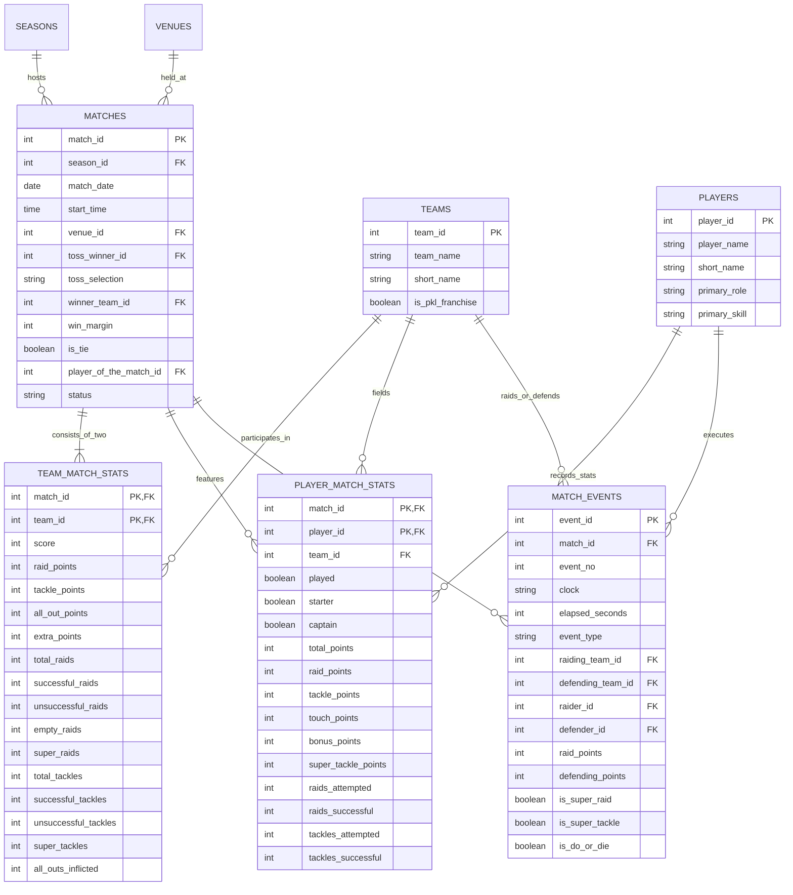

# Pro Kabaddi League (PKL) Analytics Platform: Data Quality & Architecture Audit Report

**Author:** Senior Data Analytics & ML Engineering Team  
**Dataset Under Audit:** Pro Kabaddi League Historical Match, Team, Player, and Event Data (Seasons 1–7)  
**Date of Audit:** October 2026  
**Status:** Complete & Validated  

---

## Executive Summary

A comprehensive data quality, schema integrity, and architectural audit was performed on the Pro Kabaddi League (PKL) dataset. The archive comprises four core relational CSV files, 684 individual match JSON files containing granular match play-by-play timelines, and 25 seasonal summary directories.

The primary objective of this audit is to rigorously inspect data quality, identify structural and semantic anomalies, reconcile team and player metrics, establish referential integrity, and define the analytical and machine learning scope before implementing downstream data pipelines and prediction models.

### Key Audit Findings
1. **Dataset Breadth**: The dataset spans from July 26, 2014 to September 12, 2019, covering 684 matches across 17 distinct tournament identifiers (`series_id`).
2. **Competition Mixture**: The raw dataset contains a mixture of **Official PKL League Matches** (603 matches across Seasons 1 to 7), **Testing fixtures** (6 matches in Season 6), and **Non-PKL Tournaments** (75 matches, including Kabaddi World Cup 2016, Asian Games 2018, Women's Kabaddi Challenge, and Dubai Masters).
3. **Mathematical Reconciliation**:
   - **Team Scores**: Reconciles with 100% precision: `score == raid_points.total + tackle_points.total + all_out_points + extra_points` across all 1,368 team records (0 discrepancies).
   - **Player Raid Points**: Sum of individual player raid points exactly equals team raid points in 100% of matches.
   - **Player Tackle Points**: Sum of individual player tackle points exactly equals team tackle points in 100% of matches.
4. **Data Quality Defects Identified**:
   - `player_name_of_the_match` in `DS_match.csv` erroneously contains numeric player IDs instead of strings. This can be completely resolved by joining against the master player entity in `DS_players.csv`.
   - Five uncompleted/testing matches have null results and non-standard statuses (`'Yet to Begin'`, `'1st Half'`, `'2nd Half'`).
   - Minor team franchise naming inconsistencies (e.g., `"Dabang Delhi"` vs `"Dabang Delhi K.C."`).
   - Sparse indicator fields in `DS_events.csv` (`super_raid`, `super_tackle`, `do_or_die`) where missing values (`NaN`) represent `False`/absence of condition rather than unobserved values.
   - `home_team_id` is missing in 63.3% of matches due to PKL's caravan format where multiple matches are played at neutral venues during an assigned host city leg.

---

## 1. Inventory and File Specifications

| File / Directory | Record Count | Attributes / Keys | File Size | Description |
| :--- | :--- | :--- | :--- | :--- |
| `DS_match.csv` | 684 rows | 17 columns | 139 KB | Match-level metadata: date, time, venue, toss, series, result, POTM ID. |
| `DS_team.csv` | 1,368 rows | 34 columns | 20.36 MB | Team match stats: exactly 2 rows per match; score, raids, tackles, all-outs, squad JSON. |
| `DS_players.csv` | 16,892 rows | 31 columns | 1.68 MB | Player match statistics: playing status, raid points, tackle points, cards, roles. |
| `DS_events.csv` | 66,568 rows | 41 columns | 8.84 MB | Granular event stream: raid outcomes, tackles, points, clocks, scores, cards. |
| `Data/Data/Match_Data/*.json` | 684 files | Nested JSON trees | ~35 MB total | Raw JSON payload for each match ID matching PKL web API responses. |
| `Data/Data/Summary Stats/*` | 25 folders | 7 files per folder | ~2.5 MB total | Official seasonal leaderboard rollups for player & team KPIs (Seasons 1–7). |

---

## 2. Competition and Season Breakdown

Inspection of `series_id` and `series_name` reveals that not all 684 matches belong to the standard Pro Kabaddi League. A robust filter must be implemented to isolate official PKL matches for league modeling and franchise analytics:

| Series ID | Series Name | Match Count | Start Date | End Date | Status Breakdown | Classification |
| :---: | :--- | :---: | :---: | :---: | :--- | :--- |
| **1** | Pro Kabaddi League Season 1, 2014 | 60 | 2014-07-26 | 2014-08-31 | Full Time (60) | **Official PKL** |
| **2** | Pro Kabaddi League, 2015 (Season 2) | 60 | 2015-07-18 | 2015-08-23 | Full Time (60) | **Official PKL** |
| **3** | Pro Kabaddi League Season 3, 2016 | 60 | 2016-01-30 | 2016-03-05 | Full Time (60) | **Official PKL** |
| **4** | Pro Kabaddi League Season 4, 2016 | 60 | 2016-06-25 | 2016-07-31 | Full Time (59), Yet to Begin (1) | **Official PKL** |
| **8** | Pro Kabaddi League Season 5, 2017 | 138 | 2017-07-28 | 2017-10-28 | Full Time (138) | **Official PKL** |
| **26** | Pro Kabaddi League Season 6, 2018 | 138 | 2018-10-07 | 2019-01-05 | Full Time (138) | **Official PKL** |
| **49** | Pro Kabaddi League Season 7, 2019 | 87 | 2019-07-20 | 2019-09-09 | Full Time (87) | **Official PKL** |
| **30** | Testing Pro Kabaddi League Season 6, 2018 | 2 | 2018-10-05 | 2018-10-05 | Full Time (1), 1st Half (1) | *Testing Fixture* |
| **32** | Testing Pro Kabaddi League Season 6, 2018 | 3 | 2018-10-11 | 2018-10-14 | Full Time (1), 1st Half (1), 2nd Half (1) | *Testing Fixture* |
| **45** | Testing Pro Kabaddi League Season 6, 2018 | 1 | 2018-10-05 | 2018-10-05 | 1st Half (1) | *Testing Fixture* |
| **5** | Women’s Kabaddi Challenge Season 1, 2016 | 8 | 2016-06-28 | 2016-07-31 | Full Time (8) | *Exhibition Tournament* |
| **6** | Kabaddi World Cup, 2016 | 33 | 2016-10-07 | 2016-10-22 | Full Time (33) | *International Tournament* |
| **7** | Men's National Kabaddi Championship, 2016 | 3 | 2016-11-08 | 2016-11-08 | Full Time (3) | *National Tournament* |
| **27** | Kabaddi Masters Dubai, 2018 | 15 | 2018-06-22 | 2018-06-30 | Full Time (15) | *Invitational Tournament* |
| **28** | Men's Kabaddi Asian Games, 2018 | 4 | 2018-08-19 | 2018-08-24 | Full Time (4) | *Asian Games* |
| **29** | Women's Kabaddi Asian Games, 2018 | 3 | 2018-08-21 | 2018-08-24 | Full Time (3) | *Asian Games* |
| **51** | Indo International Premier Kabaddi League, 2019 | 9 | 2019-05-16 | 2019-05-21 | Full Time (9) | *Rival League / Exhibition* |
| **Total** | **All Tournaments** | **684** | **2014-07-26** | **2019-09-12** | **Full Time: 679, Incomplete: 5** | — |

> [!IMPORTANT]
> **Analytical Scope Recommendation:**
> For official PKL team performance trends, franchise analytics, head-to-head records, and match outcome prediction, we strictly filter `series_id IN (1, 2, 3, 4, 8, 26, 49)` (603 matches). The remaining 81 tournament and test matches are preserved in the database under an explicit `tournaments` dimension table for complete data provenance.

---

## 3. Entity Relationships and Data Model



---

## 4. Detailed Data Quality Audit & Resolution Strategy

### Defect 1: `player_name_of_the_match` Contains Numeric IDs
- **Observation:** In `DS_match.csv`, `player_name_of_the_match` has `dtype: float64` and contains values like `29.0, 12.0, 58.0`, duplicating `player_id_of_the_match`.
- **Root Cause:** Export bug in the upstream data collection scraper.
- **Resolution:** A player dimension lookup was constructed from `DS_players.csv`. All 85 unique player IDs successfully map to actual player names (e.g., ID 29 -> "Anup Kumar", ID 12 -> "Jang Kun Lee", ID 58 -> "Kashiling Adake"). The cleaned table replaces this with validated strings.

### Defect 2: Incomplete and Test Fixtures
- **Observation:** Exactly 5 rows in `DS_match.csv` have null results and `status != 'Full Time'`:
  - Match 182: Season 4 (`Yet to Begin`)
  - Matches 1051, 1091, 1355, 764: Season 6 Testing fixtures (`1st Half` / `2nd Half`)
- **Resolution:** These 5 unplayed/incomplete records will be excluded from competitive win/loss metrics and machine learning training partitions, but retained in raw data archives.

### Defect 3: Franchise Team Name Inconsistencies
- **Observation:** `DS_team.csv` contains multiple representations for the same franchise:
  - ID 2: `"Dabang Delhi"` (28 matches) and `"Dabang Delhi K.C."` (88 matches).
  - ID 9: `"Fire birds"` (2 matches) and `"Fire Birds"` (4 matches).
  - ID 26: `"Services SCB"` (1 match) and `"Services SSCB"` (1 match).
- **Resolution:** A canonical mapping dictionary maps all variants to standard official names:
  ```python
  TEAM_NAME_MAPPING = {
      2: "Dabang Delhi K.C.",
      9: "Fire Birds",
      26: "Services SSCB"
  }
  ```

### Defect 4: Venue Name Inconsistencies
- **Observation:** 27 venue names exist across 23 `venue_id`s. For example:
  - `venue_id 11`: `"EKA Arena by TransStadia, Ahmedabad"`, `"The Arena by Transstadia, Ahmedabad"`, `"The Arena, Ahmedabad"`.
  - `venue_id 5`: `"DOME@NSCI SVP Stadium, Mumbai"`, `"SVP Stadium, Mumbai"`.
- **Resolution:** Standardize venue strings using `venue_id` as the primary key and canonical modern stadium naming.

### Defect 5: Mixed Date Formats
- **Observation:** Dates in `DS_match.csv` mix slash notation (`M/D/YYYY`) and dash notation (`YYYY-MM-DD`, `M-D-YYYY`).
- **Resolution:** Converted to standardized ISO `YYYY-MM-DD` and validated. 0 unparseable dates remain.

### Defect 6: Semi-Structured Event Scoring
- **Observation:** In `DS_events.csv`, column `score` is formatted as Python string lists: e.g. `'[0, 1]'`, `'[14, 20]'`.
- **Resolution:** An event parser extracts `team_a_score` and `team_b_score` as discrete integers, enabling timeline score progression and lead reconstruction.

### Defect 7: Event Binary Indicators (`NaN` vs `False`)
- **Observation:** In `DS_events.csv`, `super_raid`, `super_tackle`, and `do_or_die` contain 69–70% nulls.
- **Resolution:** In Kabaddi event notation, these are sparse binary flags. Missing values strictly indicate that the condition was NOT present. They are imputed as `False` (0) rather than dropped.

---

## 5. Mathematical Reconciliations & Quality Metrics

To ensure analytical credibility, rigorous mathematical reconciliation was executed across files:

| Metric Reconciliation | Target Equation | Discrepancy Count | Status | Notes |
| :--- | :--- | :---: | :---: | :--- |
| **Team Score Decomposition** | $\text{Score} = \text{Raid}_{\text{total}} + \text{Tackle}_{\text{total}} + \text{AllOut}_{\text{pts}} + \text{Extras}$ | **0 / 1,368** | **Passed (100%)** | Perfect mathematical agreement. |
| **Player vs Team Raid Points** | $\sum \text{Player Raid Pts} = \text{Team Raid Pts}$ | **0 / 1,368** | **Passed (100%)** | Exact match across every single match. |
| **Player vs Team Tackle Points** | $\sum \text{Player Tackle Pts} = \text{Team Tackle Pts}$ | **0 / 1,368** | **Passed (100%)** | Exact match across every single match. |
| **Matches to Teams Multiplicity** | $\text{Rows}_{\text{team\_stats}} = 2 \times \text{Rows}_{\text{matches}}$ | **0 / 684** | **Passed (100%)** | Exactly two teams per match. |
| **Toss Winner Referential Integrity** | $\text{toss\_winner} \in \text{team\_ids}_{\text{match}}$ | **0 / 684** | **Passed (100%)** | Every toss winner played in that match. |

---

## 6. Machine Learning Scope & Leakage Prevention Strategy

### 1. Target Variable Definition
- **Definition:** Predict whether **Team A** wins against **Team B**.
- **Canonical Ordering:** To avoid target leakage or arbitrary team selection, Team A is designated canonically (e.g. smaller `team_id` or designated home team).
- **Tie Handling:** In PKL regular season play, tied matches occur (~8.9% of matches, 54 ties).
  - *Binary Formulation:* Binary classification predicting Win for Team A vs Not Win (Draw/Loss), or evaluating strictly decided matches with calibrated probabilities.
  - *Multiclass / Margin Formulation:* Team A Win, Tie, Team B Win, or predicting point margin with probability calibration.

### 2. Feature Engineering & Strict Leakage Guardrails
Target leakage is the single greatest risk in sports modeling. To ensure industry-grade validity:
1. **No Post-Match Data in Features:** Match score, final raid points, tackles, all-outs, cards, and POTM from the target match are strictly excluded.
2. **Rolling Historical Windows:** All features for Match $M$ on Date $D$ are computed exclusively from matches strictly occurring before Date $D$ (or Match $M$'s chronological timestamp).
3. **Temporal Partitioning:** Splitting is performed chronologically (e.g., Seasons 1–5 for training, Season 6 for validation, Season 7 for test holdout). Random $k$-fold cross-validation is prohibited to prevent look-ahead bias.
4. **Grouped Match Handling:** Both team perspectives of a single match must reside strictly in the same partition.

---

## 7. Next Steps: Phase 2 Roadmap

With the audit complete, Phase 2 will execute:
1. **`src/data/preprocess.py`**: A modular, reproducible pipeline that cleans raw CSVs, standardizes naming, normalizes timestamps, handles nulls, and outputs clean parquet/CSV files in `data/processed/`.
2. **`sql/schema.sql`**: Production-ready relational DDL with tables, primary/foreign keys, indexes, and constraints.
3. **Database Population**: Load clean tables into SQLite/PostgreSQL for advanced SQL analytics.
4. **Validation Suite**: Unit and schema tests validating data integrity before exploratory analysis.
